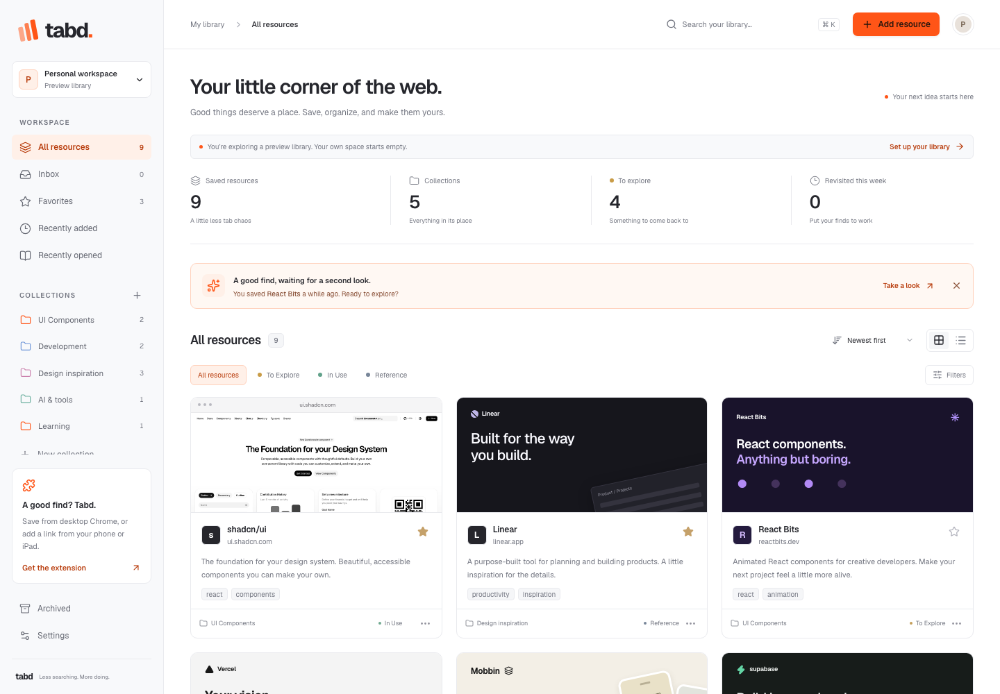
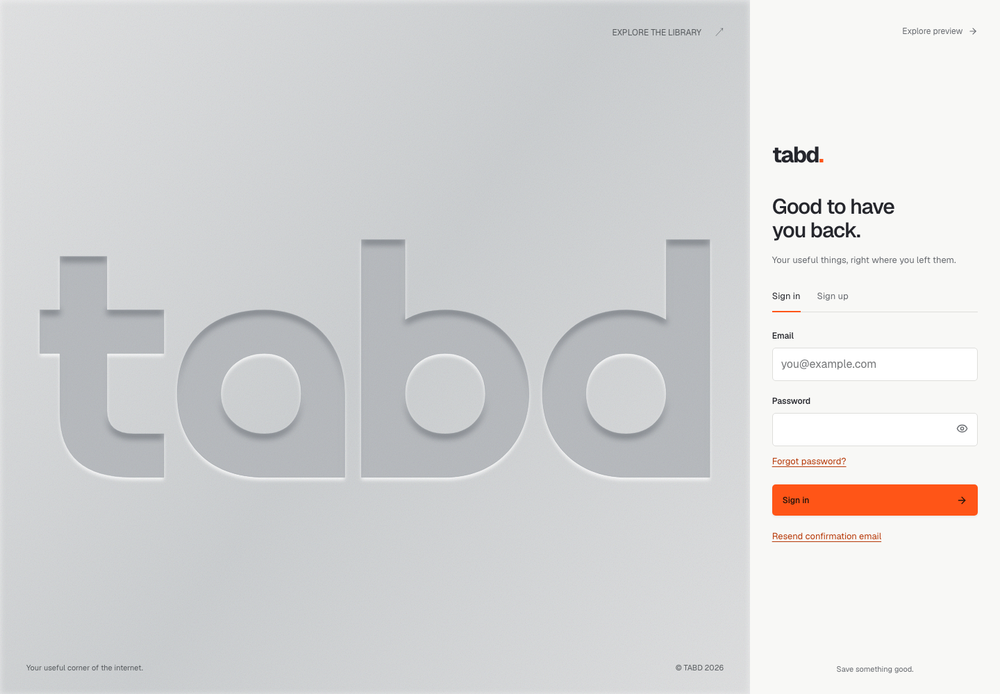
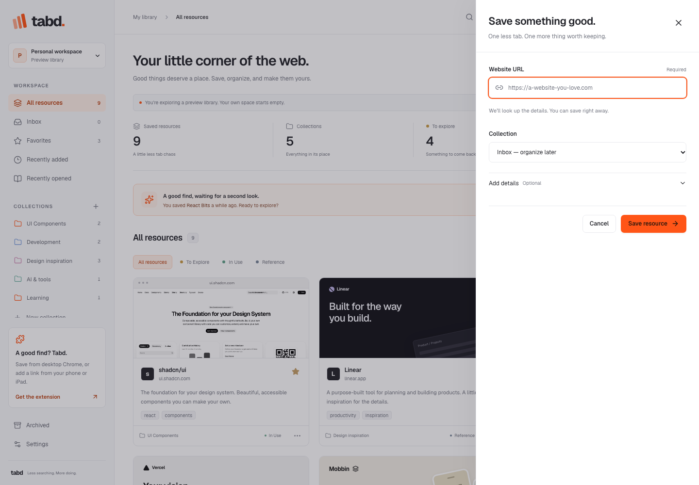
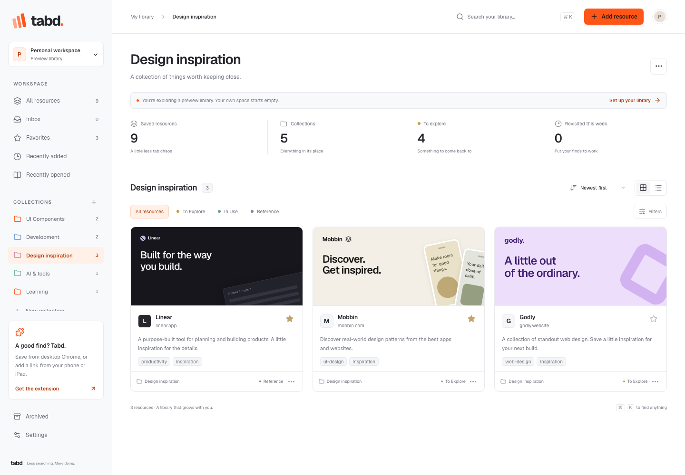
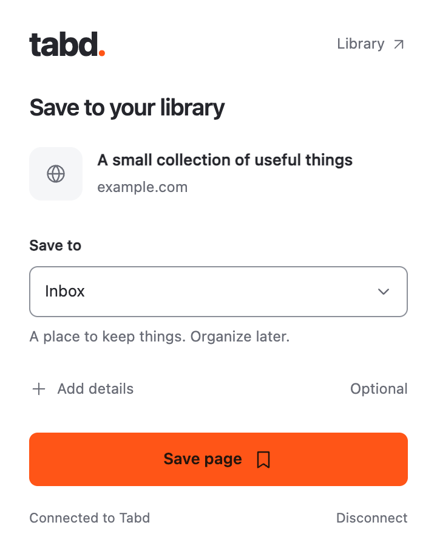

# Tabd

[](https://github.com/Zor0000/Tabd/actions/workflows/ci.yml)

A developer-first personal web library. Next.js dashboard first, with a WXT Chrome extension using the same authenticated API and Supabase database.

Built with Next.js 16, React 19, TypeScript, Tailwind CSS 4, Supabase/PostgreSQL, and WXT. Save useful links, organize them into collections, and find them again from the dashboard or Chrome extension.

## Live website

**[Open Tabd → www.tab-dd.tech](https://www.tab-dd.tech)**

[Sign in or create an account](https://www.tab-dd.tech/login) · [Explore the preview library](https://www.tab-dd.tech/preview) · [Download the Chrome extension pilot](https://github.com/Zor0000/Tabd/releases/tag/extension-v0.1.1)

Use the deployed website directly—no local setup is needed. The public preview lets you explore a sample library without an account; saving and changing resources require signing in. Your own library starts empty.



*Website screenshots captured from the deployed site on 20 October 2026. Library screenshots use public preview data, not a personal account.*

## How to use Tabd

### 1. Create your account

1. Open [Sign in](https://www.tab-dd.tech/login), then choose **Sign up**.
2. Enter your email, password, and password confirmation, then select **Create account**.
3. If prompted, open the confirmation email to finish setup. Use **Resend confirmation email** if you need another link, and check your spam folder.
4. Sign in to open your personal library. Returning users can use **Forgot password?** to request a reset link.



### 2. Save a useful link

1. In your library, select **Add resource**.
2. Paste a complete HTTP or HTTPS link into **Website URL**.
3. Choose a **Collection**, or leave **Inbox — organize later** selected.
4. Expand **Add details** to add a title, description, status, comma-separated tags, or personal notes.
5. Select **Save resource**. Tabd retrieves page details and previews in the background; you can save without waiting for them.

If the link is already saved, review the duplicate notice and choose **Update existing resource** to update it. On a phone or tablet, copy the page's URL and use the same **Add resource** flow.



*The form is shown in preview mode for illustration; sign in to persist a save.*

### 3. Organize your library

- Choose **New collection** or the **+** beside **Collections**, enter a name, optionally choose a parent and color, then select **Create collection**. Collections support up to three levels.
- Open a resource's **…** menu and choose **Edit or move** to change its details or collection.
- Set a resource's status to **To Explore**, **In Use**, or **Reference**. Use the star to keep it in **Favorites**.
- Choose **Archive resource** to put a link aside. Find it under **Archived**, then choose **Restore to library** when you need it again.
- To edit a collection, open it and use its **…** button. Deleting a collection moves its direct resources to **Inbox** and makes its subcollections top-level; it does not delete the resources.



### 4. Find and revisit links

Type into **Search your library** to match titles, descriptions, website hostnames, tags, and notes. Search respects the selected sidebar section and filters; select **All resources** and clear filters to broaden your results. Archived links are searched from **Archived**.

Use the status tabs and **Filters** to narrow results, the sort menu to change their order, and the grid/list buttons to switch views. **Recently added**, **Recently opened**, and **Favorites** provide shortcuts. Open a resource to visit the original website; opening history records visits made through Tabd.

### 5. Save from desktop Chrome

The extension is currently an **unpacked pilot release**, with no live Chrome Web Store listing. New installations need the Tabd operator to register their extension ID before pairing.

1. Download and extract the ZIP from the [extension release](https://github.com/Zor0000/Tabd/releases/tag/extension-v0.1.1).
2. Open `chrome://extensions`, enable **Developer mode**, choose **Load unpacked**, and select the extracted folder containing `manifest.json`.
3. Have the Tabd operator register the displayed extension ID. See the [installation and update guide](docs/extension-release.md) for details.
4. Sign in to [Tabd](https://www.tab-dd.tech/login) in the same browser profile. Open the extension, choose **Connect to Tabd**, and confirm **Connect this extension** on the website.
5. Visit a normal website, open the extension, choose a collection, and save. Use **Add details** for optional fields. Return to the dashboard to see the saved link; the library refreshes on window focus.



*Example popup screenshot used on the Tabd landing page.*

Chrome internal pages cannot be saved. If pairing fails, check that your extension ID has been registered, reload the extension, and refresh the connection page in the same browser profile. Reconnect when access expires.

### 6. Adjust settings and connect agents

Open **Settings** to choose a light or dark appearance, default resource view, and default save collection. These preferences are remembered in the current browser. Choose **Export library as JSON** to download your resources, collections, tags, and notes.

For coding-agent access, choose **Settings → Connect coding agents** and follow the [MCP setup guide](docs/mcp.md). Agent access is read-only and uses separate, revocable tokens. Use **Revoke extension access** in Settings to invalidate extension connections; signing out of the website alone does not revoke them.

---

The sections below cover local development, configuration, and deployment.

## Current status

Implemented: dashboard, protected account routes, email/password authentication, optional Google OAuth, save/edit/delete, duplicate detection and update, three-level collections, favorites, archive, status management, database full-text search, client filtering, grid/list preferences, opening history, revisit suggestions, JSON export, profile name, light/dark themes, metadata retrieval, and Chrome account linking.

Without environment variables the app shows a clearly labeled, read-only preview. A fresh clone needs its own Supabase configuration for account features. Credentials belong in the ignored `.env.local`; they are not included in this repository. Live registration, email delivery, and extension-to-hosted-database acceptance still need to be checked for each configured environment.

## Run the dashboard

Use Node.js 26 (`.nvmrc`). The test tooling also supports Node.js 22.12+ within the 22.x release line and Node.js 24.x. Use npm and the committed lockfiles for reproducible installs.

```sh
git clone https://github.com/Zor0000/Tabd.git
cd Tabd
nvm use
npm ci
npx playwright install chromium
cp .env.example .env.local
npm run dev
```

This repository is public. If you do not use nvm, install Node.js 26 before running the npm commands.

Open http://localhost:3000. If that port is occupied, use `npm run dev -- --port 3210` and use that origin in the setup below. `/preview` always opens the sample library; real signed-in accounts start empty.

## Connect Supabase

1. Create a new project in the Supabase dashboard. Do not use an unrelated project's credentials.
2. Apply every SQL file in `supabase/migrations/` in filename order, or use the CLI commands below. This includes the initial library schema and the collection parent index.
3. From the project's Connect/API Keys settings copy its project URL and publishable key to `.env.local`:

```dotenv
NEXT_PUBLIC_SUPABASE_URL=https://YOUR_PROJECT.supabase.co
NEXT_PUBLIC_SUPABASE_PUBLISHABLE_KEY=YOUR_PUBLISHABLE_KEY
SUPABASE_SECRET_KEY=YOUR_SERVER_ONLY_SECRET_KEY
NEXT_PUBLIC_APP_URL=http://localhost:3000
NEXT_PUBLIC_GOOGLE_AUTH_ENABLED=false
NEXT_PUBLIC_EXTENSION_IDS=
```

The initial migration is **`supabase/migrations/20261011091851_initial_library.sql`**; **`supabase/migrations/20261011140406_index_collection_parent.sql`** adds the collection parent index. Use `npx supabase login`, `npx supabase link --project-ref YOUR_PROJECT_REF`, and `npx supabase db push` to apply all migrations using the CLI. Inspect the linked project before pushing.

The publishable key is safe in the browser because tables enforce RLS. The secret key (or legacy service-role key) is **server-only**, used to validate extension and MCP tokens and operate on the validated owner's rows. MCP operations are read-only. Never add the secret key to the extension, `NEXT_PUBLIC_*`, or source control. Web dashboard operations use the user's session and RLS, not the secret key.

4. In Authentication → URL Configuration, set the Site URL to your application origin and add `http://localhost:3000/auth/callback` to allowed redirects (substitute your actual port). Add your production callback before deployment.
5. Email authentication is enabled in Supabase by default. Decide whether email confirmation is required; for production configure SMTP. The app clearly asks unconfirmed users to check email.
6. Optional Google OAuth: configure Google credentials in Supabase, then set `NEXT_PUBLIC_GOOGLE_AUTH_ENABLED=true`. Google must allow the Supabase provider callback URL shown in its dashboard.
7. Restart Next.js, visit `/login`, and create an account.

## Install the Chrome extension locally

```sh
cd extension
npm ci
cp .env.example .env
npm run dev
```

Set `WXT_APP_URL` in `extension/.env` to your local dashboard origin for development. The development default is `http://localhost:3000`. Production builds (`npm run build --prefix extension` from the repository root) deliberately target `https://www.tab-dd.tech` and ignore local `.env` origin values. Use an explicit HTTPS `WXT_APP_URL` environment variable to build for another hosted instance. For local development, the extension discovers Tabd on `localhost` or `127.0.0.1`, verifies `/api/extension/status`, and remembers the address used for a successful link. If you start Tabd on another port, open its dashboard in the same browser; no extension rebuild is needed for that port change. Hosted builds allow only the configured origin and must be rebuilt after changing its domain.

1. Open `chrome://extensions` and enable Developer mode.
2. Click **Load unpacked** and choose the directory reported by WXT (normally `extension/.output/chrome-mv3-dev` for `npm run dev`). Production builds use `extension/.output/chrome-mv3`.
3. Copy its extension ID. Add it to `NEXT_PUBLIC_EXTENSION_IDS` in the web app's `.env.local`, then restart the web app. Multiple trusted development IDs can be comma-separated.
4. Sign in to the web app. Open the extension and choose **Connect to Tabd**.
5. Review and click **Connect this extension** on the web page.
6. Open a normal HTTP/HTTPS website. Click the extension, select a collection if wanted, and save. Status, tags, and notes are optional.
7. Switch back to the dashboard; it refreshes on window focus. The new resource appears in the same account.

The extension needs only `activeTab`, `storage`, and host access to the configured dashboard origin. Local development builds allow HTTP on `localhost` and `127.0.0.1` across ports; hosted builds stay on the configured origin. It does not request browsing history or access to every website. Chrome internal pages cannot be saved. It reads the active tab's URL, title and favicon. The web save form additionally extracts description and Open Graph preview metadata.

The popup follows your system's light or dark appearance. It remembers the last saved collection and shows nested collections with their full path. Title, status, tags, and notes stay behind **Add details**, with the save action always visible. Saving an existing page loads its current details; **Save changes** updates only fields you edit, preserving existing notes and tags. Connection failures can be retried, and expired access prompts you to reconnect.

After rebuilding, click **Reload** on Tabd in `chrome://extensions` to use the updated popup.

If connecting reports that the extension cannot be reached, reload the installed extension and refresh the connection page. The app and extension must be in the same browser profile. A missing messaging API can indicate a stale page, disabled extension, a different profile, or an unsupported browser; it does not mean you need to reinstall. The app pings the extension before issuing an account token and reports connection failures with recovery steps. If the extension cannot find Tabd, start the server and open its dashboard before trying again; unrelated apps on familiar ports are ignored.

### Linking security

A signed-in web session creates a 256-bit random, account-scoped token, with a 30-day lifetime. Only its SHA-256 hash is stored in PostgreSQL. The web app sends the token directly to an explicitly allowed extension ID using Chrome external messaging. The extension checks the sender's origin, verifies the token against the API, then stores it in extension-local storage. Credentials never travel through a URL or accessible browser cookie. Every extension request resolves the token owner server-side, verifies collection ownership, and scopes all reads/writes to that owner. Revocation is available in Settings. Disconnecting in the popup removes the local token; use **Revoke extension access** to invalidate all issued tokens. Web sign-out alone does not revoke extension links.

## Architecture

See the [architecture overview](docs/architecture.md) for the component map and storage model, and [data-flow guide](docs/flow.md) for the save, search, preview recovery, and agent journeys.

### Personal-library MCP

Connect coding agents from **Settings → Connect coding agents** (`/agents`). Tabd exposes five read-only tools for library search, references, collections, explicit taste preferences, and design context at `/api/mcp`. Agent tokens are separate from extension tokens, expire after 30 days, and can be revoked individually.

Apply the `20261012121313_personal_library_mcp.sql` migration before using this feature. See [MCP setup, tool behavior, and verification](docs/mcp.md) for connection instructions and current limits. This release uses keyword search, user-written preferences, and existing preview metadata; component capture and semantic search are future work.

```text
app/                 Next.js pages, auth callback and Route Handlers
components/          Dashboard, resource cards, save/collection panels
components/ui/       Reusable Radix/shadcn-style button and dialog primitives
lib/                 Types, Zod validation, URL normalization, API auth, metadata
lib/supabase/        Browser and server session clients
supabase/migrations/ PostgreSQL schema, indexes, triggers and ownership policies
extension/           WXT Manifest V3 React popup and account-link background worker
tests/               Validation, SSRF, PostgreSQL/RLS and Playwright browser tests
```

- Browser → Route Handler → Supabase with verified auth session. Extension → same Route Handlers → verified token owner.
- `bookmarks`, `collections`, `profiles`, `extension_tokens` all enable RLS. Composite foreign keys prevent cross-user collection assignments. Hierarchy writes reject cycles and depth beyond three levels.
- Deleting a collection moves its direct resources to Inbox and promotes its children to top-level collections; it never deletes resources.
- Tags are a validated `text[]` on each bookmark, with GIN indexing. This simpler MVP structure avoids an unnecessary join table and makes tags atomic with saves.
- Full-text search spans title, description, hostname, notes and tags with a PostgreSQL `tsvector` and GIN index. The dashboard loads the complete library in batches of 500 and consistently applies local substring matching. The resource API and MCP also support database keyword search.
- URL normalization drops fragments and common tracking parameters, preserves meaningful query parameters and sorts them for stable duplicate detection. HTTP/HTTPS remain distinct.
- Open tracking is atomic and records only opens through Tabd. Archive is independent from status.
- Metadata requests allow HTTP/HTTPS on standard ports, reject private and special-use IPs, pin validated DNS results into the connection, validate each redirect, cap redirects, limit page responses to 512 KiB, and time out DNS and network activity. HTML is parsed without executing scripts. Metadata failure never prevents saving the URL.
- Saved websites receive lazy landing-page captures through `/api/resources/[id]/preview`. The route verifies account ownership before reading the saved URL. Chromium runs in a fresh context; all page and asset requests pass through the same DNS-pinned public-address checks. Downloads, service workers, WebSockets, and non-GET requests are blocked. Captures have bounded time, request, byte, queue, and concurrency limits and a one-hour, 32-image server cache. If capture fails, cards fall back to the site's Open Graph image, then their text preview. Captures are stored permanently in the private `website-previews` Storage bucket under the account owner and bookmark ID, with a URL hash to prevent reuse after a URL edit. Stored captures are reused across server restarts. Apply the durable metadata migration before deployment; existing bookmarks then recover without re-saving.
- Metadata enrichment runs after an actual save request using Next.js `after`, and incomplete bookmarks resume when visible in the library or when the browser reconnects. Attempts, leases, cooldowns, and last-good metadata live in the owner’s bookmark row. Transient failures retry after 1 minute, 5 minutes, 30 minutes, 6 hours, then daily during app use; `Retry-After` is honored. Successful metadata has no expiry or automatic refresh schedule. There are no cron jobs, external schedulers, or long-running chat tasks. User edits survive enrichment, and URL changes invalidate stale results.
- Preferences (theme, default view, default collection) are per-browser. Account resources live in Supabase. No sample data is inserted into real accounts.

## TypeScript tooling

Dashboard type checks use the pinned TypeScript 7.0.2 native compiler. The `typescript` package name resolves to Microsoft’s `@typescript/typescript6` compatibility package so Next.js and typescript-eslint retain the compiler API they need. The typecheck script calls the native compiler explicitly because npm can resolve the shared `tsc` binary to a transitive TypeScript 6 installation. The extension keeps its independent TypeScript configuration and lockfile.

## Validation

```sh
npm run typecheck
npm run lint
npm test
npm run build
npx playwright install chromium webkit
npm run test:e2e
npm run test:responsive
npm run build --prefix extension
npm run typecheck --prefix extension
npm run test:extension
```

The browser tests start their own preview server on port 3210 with backend credentials disabled and isolated output in `.next-test`, so the normal development server can remain running. They refuse to reuse an existing server. If the port is occupied, run `TABD_TEST_PORT=3211 npm run test:e2e`. `npm run test:responsive` checks a 320px phone, iPhone WebKit, portrait and landscape iPad WebKit, a short landscape phone, and desktop. It covers touch targets, navigation focus and scrolling, filters, list actions, editing, save forms, landing navigation, and account entry. These are browser emulations, not physical-device tests. `npm test` includes PGlite schema tests that create two users and verify RLS isolation, ownership integrity, hierarchy constraints, deletion semantics, duplicate constraints, full-text search and atomic open tracking.

`npm run test:extension` loads a local-development build in Chromium and exercises saving, duplicate preservation, retries, expired access, restricted pages, keyboard disclosure, and validation with controlled API responses. It also uses synthesized touch input in narrow and short windows to verify that details scroll and Save remains reachable. A second suite uses real webpage-to-extension messaging and isolated HTTP servers to verify ping/link replies, token verification, port changes without rebuilding, saving to the discovered server, and rejection of unrelated sites. To capture popup states, run `TABD_EXTENSION_SCREENSHOTS=artifacts/extension npm run test:extension`. These checks do not replace the hosted account acceptance below.

GitHub Actions runs linting, both typechecks, unit/database tests, both production builds, desktop/mobile browser tests, and the extension smoke test on pushes to `main` and pull requests. CI needs no production credentials. Dependabot checks dashboard, extension, and GitHub Actions dependencies monthly.

### Hosted acceptance checklist (requires your new project)

1. Register users A and B. Confirm emails if enabled.
2. As A, create UI Components and a nested React collection.
3. Connect the unpacked extension, visit https://ui.shadcn.com/, select UI Components, save with a note.
4. Refocus dashboard, search the resource, open it, set In Use, favorite it, edit its note and move it to React.
5. Save the same URL again and confirm the existing-resource update flow.
6. Log out and back in; confirm persistence. Sign in as B and confirm A's resources are inaccessible.
7. Delete React and confirm its resources are in Inbox. Archive and restore a resource.
8. Revoke extension access and confirm the extension requires reconnection.

## Deploy

Deploy the root directory to any Node-compatible Next.js host. Run `npm ci` and `npm run build`; serve with `npm start` or the host's Next.js adapter. Configure the same environment variables in the hosting provider's secret settings before building. Use HTTPS, update Supabase's Site URL and allowed callback, and set `NEXT_PUBLIC_APP_URL` to the production origin. Keep private routes and API responses uncached.

Apply `supabase/migrations/20261013124710_durable_website_metadata.sql` to the intended Tabd project before deploying this update. It adds recovery state, an atomic completion function, and a private screenshot bucket with ownership policies. It preserves existing bookmarks; the initial backfill happens through normal authenticated app usage. No separate scheduler, credentials, or external capture service is required.

Landing-page previews use bundled `@sparticuz/chromium` on Linux, with its binaries included in the preview route's Next.js file trace. Allow at least 1 GB of memory and 60 seconds for that route. On macOS/Windows, run `npx playwright install chromium` on the runtime host. A Linux host with its own Chromium can set `TABD_CHROMIUM_PATH` to the executable's absolute path instead. Captures are of public pages without your browsing session; login walls or sites that refuse automation can fall back to metadata imagery. Preview failures never block saving.

Rebuild the extension with `WXT_APP_URL=https://YOUR_APP_ORIGIN`, load it in Chrome, and allow its resulting ID in the deployed `NEXT_PUBLIC_EXTENSION_IDS` setting. Local unpacked installation is supported; Chrome Web Store publication is not part of this deliverable.

## Remaining limitations

- Live hosted auth, SMTP/OAuth and extension/account acceptance remain unverified until a Supabase project is connected.
- Browser bookmark HTML import is deferred (lower priority in the brief). JSON export is implemented.
- Profile display-name editing is implemented; avatar upload is not.
- The extension reads the current tab title/favicon without injecting content scripts. Both web and extension saves receive server-side metadata enrichment after saving.
- The dashboard refetches on window focus; it does not subscribe to realtime events while continuously focused.
- Large libraries are paginated over the API but rendered locally without list virtualization.
- An npm audit finding in the ESLint-only development dependency chain (`braces` via Next's lint plugin) currently has no compatible patched version; production dependencies are audited separately. Do not downgrade Next's ESLint configuration across major versions to suppress it.

## Repository workflow

The default branch is `main`. Create a focused feature or fix branch and open a pull request using the included template. See [CONTRIBUTING.md](CONTRIBUTING.md) for the development workflow and [SECURITY.md](SECURITY.md) for reporting vulnerabilities.

Git tracks source code, database migrations, environment templates, and both npm lockfiles. Local secrets, dependency directories, build output, test reports, and review screenshots are ignored. Editor and line-ending conventions are defined in `.editorconfig` and `.gitattributes`.

The source repository is public, but no open-source license has been granted. Public visibility does not grant general reuse or redistribution rights. See dependency packages for their respective licenses.
