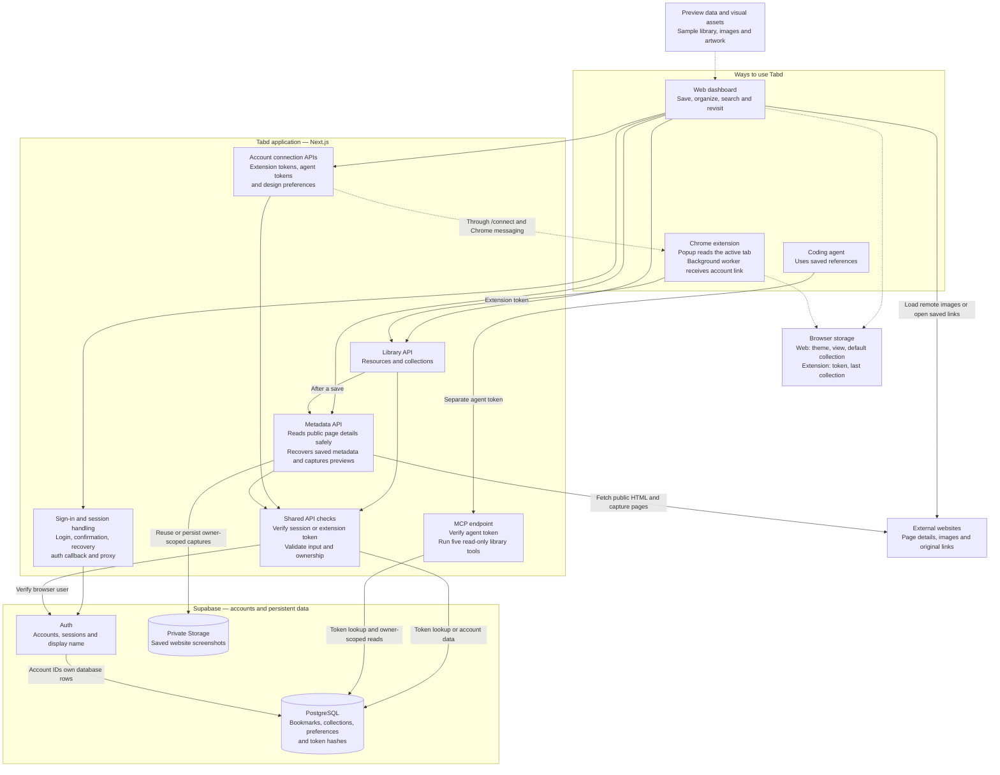

# Tabd architecture

Tabd is one personal library with three ways to access it: the web dashboard, the Chrome extension, and a coding agent. The dashboard and extension can change the library; agents can only read it.

This describes the code in this repository as of 15 October 2026. It is a code overview, not confirmation of a live deployment. Read [the flow diagram](flow.md) next.

## How the parts connect

An arrow means “calls or uses.” Replies return along the same connection. Dashed arrows show local storage, sample data, or the one-time extension link.

The server boxes are modules inside one Next.js application, not separate deployed services. **MCP** is the protocol a coding agent uses to call Tabd's tools. The agent and its model run outside Tabd.

## Component guide

Small visual components are grouped below so the diagram stays readable. Paths are relative to the repository root.

| Part | What it does and what it connects to | Main files |
| --- | --- | --- |
| App shell and pages | Provides the shared layout, styles, loading destinations, error and not-found screens. `/` shows the landing page to signed-out visitors and the dashboard to signed-in users; `/preview` shows sample data. | `app/layout.tsx`, `app/globals.css`, `app/page.tsx`, `components/landing-page.tsx`, `app/preview/page.tsx`, `app/error.tsx`, `app/not-found.tsx` |
| Dashboard | Holds library state, filters and search results. Calls the library APIs, refreshes on window focus, and exports the loaded library as JSON. | `components/dashboard.tsx` |
| Library interface | Dashboard opens `SaveResource` and `CollectionEditor`; resource cards show saved links and trigger actions. Buttons and dialogs are shared building blocks. | `components/save-resource.tsx`, `components/collection-editor.tsx`, `components/resource-card.tsx`, `components/ui/` |
| Preview visuals | Sample records feed preview mode. Site-specific images and artwork help render cards. The wordmark is shared by the landing page and account interface. | `lib/preview.ts`, `lib/site-previews.ts`, `components/preview-art.tsx`, `components/auth-wordmark.tsx`, `public/previews/` |
| Account and session handling | Login, email confirmation and password recovery use Supabase Auth. The callback exchanges an auth code for a session. The proxy refreshes cookie sessions; pages and APIs perform their own account checks. Display-name changes go directly to Supabase Auth. | `components/auth-form.tsx`, `components/auth-confirm.tsx`, `components/update-password.tsx`, `app/auth/callback/route.ts`, `proxy.ts`, `lib/supabase/` |
| Shared API helpers | Verify the browser session or extension token, limit request size, check collection ownership, and return data or errors. Shared schemas check fields and normalize URLs. | `lib/api.ts`, `lib/validation.ts`, `lib/types.ts`, `lib/utils.ts` |
| Library API | List, create, edit and delete resources and collections. Resources are stored in the `bookmarks` table. Also handles database search and opening history. | `app/api/resources/route.ts`, `app/api/resources/[id]/route.ts`, `app/api/collections/route.ts`, `app/api/collections/[id]/route.ts` |
| Website metadata and captures | Reads page details before a web save and enriches web/extension saves after saving. Recovery state persists on bookmarks and resumes when visible or after reconnecting. Captures public pages in Chromium and reuses owner-scoped screenshots from private Storage. All fetches validate public addresses, redirects, response size and time limits; failures still allow saving. | `app/api/metadata/route.ts`, `app/api/resources/[id]/metadata/route.ts`, `app/api/resources/[id]/preview/route.ts`, `lib/metadata.ts`, `lib/resource-metadata.ts`, `lib/public-fetch.ts`, `lib/website-capture.ts`, `lib/preview-storage.ts` |
| Extension and linking | `/connect` sends a new token to an allowed extension. Its background worker checks the sender and verifies the token, then stores it. The popup calls the library API with that token. | `app/connect/page.tsx`, `app/api/extension-token/route.ts`, `extension/entrypoints/background.ts`, `extension/entrypoints/popup/main.tsx`, `extension/wxt.config.ts` |
| Agent settings | Creates, lists and revokes agent tokens, and edits user-written design preferences. These APIs require a browser session. | `app/agents/page.tsx`, `components/agent-settings.tsx`, `app/api/mcp-tokens/route.ts`, `app/api/taste-profile/route.ts` |
| Agent access | Verifies a separate MCP token and reads only its owner's library. The five tools are `search_library`, `get_reference`, `get_collection`, `get_taste_profile`, and `get_design_context`. | `app/api/mcp/route.ts`, `lib/mcp/auth.ts`, `lib/mcp/server.ts`, `lib/mcp/library.ts` |
| Database rules | Migrations define tables, account isolation, URL uniqueness, collection nesting, search indexes, and database functions. Tests and build configuration support development rather than the live request path. | `supabase/migrations/`, `tests/`, `scripts/mcp-smoke.mjs`, `package.json` |

## What is stored where

| Store | Contents and relationships |
| --- | --- |
| Supabase Auth | User accounts and sessions. The current interface saves the display name in Auth user metadata. |
| `bookmarks` | Each saved URL belongs to one user and optionally one collection. Includes notes, tags, status, favorite/archive flags, image URLs, opening history and metadata recovery state. One normalized URL per user. |
| `collections` | Each collection belongs to one user and may have a parent collection owned by that user. Maximum three levels; cycles are rejected. |
| `extension_tokens` | Hashed extension credentials, owner and expiry. Grants library read/write access through the API. |
| `mcp_tokens` | Separately hashed, named agent credentials, owner and expiry. Grants read-only MCP access. |
| `taste_profiles` | One user-written design-preference record per user. |
| `profiles` | A profile table exists in the schema, but the current interface does not use it for display-name editing. |
| Private `website-previews` Storage bucket | JPEG captures keyed by owner ID, bookmark ID and normalized-URL hash. Ownership policies restrict access; the URL hash prevents reuse after URL edits. |
| Browser storage | Theme, view and default collection stay in the web browser. Extension storage holds its token and last collection. These stores are not the saved library. |

All six public tables have row-level security: database rules restricting which user's rows a normal signed-in session can access. Extension and MCP requests use a server-only secret key, so their code explicitly restricts queries to the verified token owner's ID. Neither client receives that key.

Preview mode uses local sample data and does not save to an account. Preview images use saved metadata URLs, bundled sample assets, or captured screenshots in private Storage. Dashboard search filters the complete paginated library locally with substring matching; the resource API and MCP also support PostgreSQL keyword search. Tabd has no built-in model inference, vector search, background crawler, or realtime subscription.
