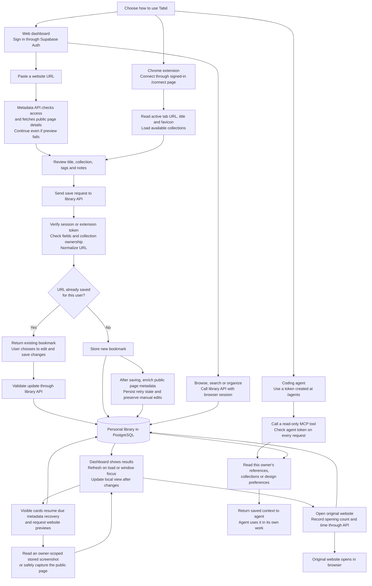

# How data flows through Tabd

The main journey is **save → organize → find → revisit or use in a coding agent**. Saved account records live in Supabase PostgreSQL; website screenshots live in its private Storage bucket.

This describes the code in this repository as of 15 October 2026. See [the architecture overview](architecture.md) for the component and file map.

## The essential flow

Read from top to bottom. The left and middle paths save links; the agent path only reads. “Library API” means the server endpoints used by the dashboard and extension.

If a session or token is invalid, the request stops and asks the user to sign in or reconnect. Invalid fields or inaccessible collections return an error before a write. The save response also confirms success to the originating dashboard or extension; the extension's changes appear in the dashboard on its next refresh.

## What happens at each stage

| Stage | Simple explanation |
| --- | --- |
| Sign in | Email/password authentication goes to Supabase Auth; Google OAuth is optional when configured. Email confirmation verifies an OTP or exchanges a code; OAuth callbacks exchange a code for a browser session. Password recovery and signed-in password updates use dedicated account pages. The server verifies the signed-in user before accessing their library. |
| Connect the extension | The user approves linking on `/connect`. The server stores a token hash and sends the actual token through that page to an allowed Chrome extension ID. The background worker checks the sender, verifies the token through the collections API, then stores it locally. |
| Save from the web | The form asks `/api/metadata` for public page details. The user can review or edit them. Metadata retrieval does not save the bookmark; submitting the form calls `/api/resources`. |
| Save from Chrome | The popup reads only the active tab's URL, title and favicon, plus optional user details. It calls the same resource API using its extension token. It does not run the web form's pre-save metadata fetch; server-side enrichment runs after saving. |
| Handle a duplicate | The database's per-user normalized-URL rule rejects a second copy. The API returns the existing record. The user can edit it and send an update; the extension preserves fields the user did not change. |
| Organize | The dashboard sends edits for collections, notes, tags, status, favorites and archive through the APIs. Deleting a collection moves its direct bookmarks to Inbox and makes its child collections top-level. It does not delete those bookmarks. |
| Find | The dashboard loads the complete library through API pages of 500 resources, then consistently filters locally while typing and afterward. Substring matching covers titles, descriptions, hostnames, personal notes and tags. The resource API also supports PostgreSQL keyword search for other callers. |
| Recover metadata and previews | Saves schedule metadata enrichment after the response. Visible cards and browser reconnects resume due attempts using persisted leases and cooldowns; successful metadata has no automatic refresh schedule. Preview requests verify ownership, reuse private Storage captures or generate them safely, then fall back to metadata imagery or text on failure. |
| Revisit | Clicking a resource opens its original URL. A separate API request calls `record_open` to update the count and last-opened time. If recording fails, the website still opens. |
| Use with an agent | The user creates a named token at `/agents` and adds it to their MCP client. Each tool call verifies that token, reads only its owner's data, and returns references or explicit preferences. The agent does its own reasoning outside Tabd. |

## A few connections worth knowing

- **Agent preferences:** `/agents` saves the user's design preferences through `/api/taste-profile` into `taste_profiles`. MCP reads those preferences alongside saved references. It does not infer taste automatically.
- **Agent search:** MCP uses the `search_library_references` database function for ranked keyword results. It does not visit external sites during a tool call. Returned previews are saved image URLs, not captured components or source code.
- **Token lifetime:** Extension and agent tokens expire after 30 days. Dashboard settings can revoke all extension tokens; `/agents` can revoke individual agent tokens. Extension disconnect removes its local token, while web sign-out alone does not revoke issued tokens.
- **Local-only actions:** Theme, view and default-collection settings stay in browser storage. JSON export is generated from the dashboard's loaded library. Neither action needs a separate backend service.
- **Preview path:** `/preview` shows a labeled sample library with account writes disabled. `/` shows the public landing page when signed out or without Supabase configuration; signed-in users see their dashboard.

For detailed agent setup and tool inputs, see [MCP documentation](mcp.md). The diagrams describe implemented paths; hosted authentication and account acceptance still need verification in the configured environment.
